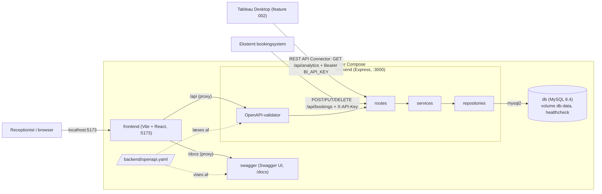

# Hotel Kong Arthur

Back office til receptionen (bookinger og barsalg) og data til ledelsens Tableau-dashboard.
Stack: Docker Compose, MySQL 8.4, Node.js 24 + Express 5 og React 19 + Tailwind 4.

Back office (feature [001](specs/001-backoffice-bookinger/spec.md)) er bygget. Til
Tableau-dashboardet (feature [002](specs/002-bi-dashboard/spec.md)) er backend-API'et bygget,
og workbooken er under arbejde.

## Arkitektur



- **Tre lag** i backend: routes (HTTP) → services (forretningsregler) → repositories (SQL).
  Et lag kalder kun laget under sig. Kun repositories kender SQL, og kun services kender
  forretningsregler og nøgletal.
- **Én kontrakt**: `backend/openapi.yaml` bruges både af validatoren, der afviser ugyldige
  requests, og af Swagger UI. Der findes ingen anden beskrivelse af API'et.
- **Én origin**: Vite-serveren i `frontend` sender `/api` videre til backend og `/docs` til
  Swagger UI. Browseren ser kun `localhost:5173`, så session-cookien virker uden CORS.
- **Databasen** bruger MySQL 8.4's standard `utf8mb4_0900_ai_ci`, så søgning på gæstenavn
  hverken skelner mellem store og små bogstaver eller accenter (FR-002). Den er kun tilgængelig inde i Compose-netværket. Frontend, Swagger og eksterne
  systemer går altid gennem API'et.
- `db` har en healthcheck, og `backend` starter først, når den er grøn. Data ligger i det
  navngivne volume `db-data` og overlever genstart.

Begrundelserne står i [`research.md`](specs/001-backoffice-bookinger/research.md) og
[`plan.md`](specs/001-backoffice-bookinger/plan.md).

## Sådan hænger koden sammen

Alle services og repositories kobles sammen ét sted, i
[`backend/src/app.js`](backend/src/app.js). Services får deres repositories, `withTransaction`
og `today` som parametre, så testene kan give dem falske udgaver uden database.

Et eksempel: **`POST /api/bookings`** (opret booking).

1. [`app.js`](backend/src/app.js): `express.json()` læser body, og `cookie-session` læser
   cookien. `express-openapi-validator` tjekker body mod `BookingInput` i
   [`openapi.yaml`](backend/openapi.yaml): typer, påkrævede felter, datoformat og `guestCount ≥ 1`.
2. [`routes/bookings.js`](backend/src/routes/bookings.js): `allowBookingSystemKey` fra
   [`auth.js`](backend/src/auth.js) godkender enten en gyldig `X-API-Key` (kilde
   `booking_system`) eller en session (kilde `backoffice`). Routen kalder servicen og svarer
   `201` med JSON.
3. [`services/bookingService.js`](backend/src/services/bookingService.js), `createBooking`:
   `validate` tjekker navn, datorækkefølge, land, værelsestype og kapacitet (FR-006).
4. I samme fil starter `withTransaction` ([`db.js`](backend/src/db.js), `READ COMMITTED`) en
   transaktion. `assignRoomAndPrice` låser typens værelser med `SELECT … FOR UPDATE` og finder
   overlappende bookinger ([`roomRepository.js`](backend/src/repositories/roomRepository.js)).
   Det første ledige værelse vælges, så to samtidige bookinger aldrig får samme værelse (FR-007).
5. Prisen beregnes nat for nat efter sæson i den rene funktion `calculateStayPrice`
   ([`services/pricing.js`](backend/src/services/pricing.js), FR-008) med perioder og priser fra
   [`pricingRepository.js`](backend/src/repositories/pricingRepository.js).
6. [`bookingRepository.js`](backend/src/repositories/bookingRepository.js) indsætter bookingen
   med den fastfrosne pris (FR-009). Transaktionen committes, og bookingen hentes igen og
   returneres med afledte felter (`nights`, `status`).
7. Bryder noget en regel, kaster servicen en `AppError` med en kode, fx
   `ROOM_TYPE_FULLY_BOOKED`. Den fælles fejl-middleware i
   [`errors.js`](backend/src/errors.js) laver den om til HTTP-status og
   `{ "error": { "code", "message", "field" } }`.

Frontend kalder kun backend gennem [`frontend/src/api.js`](frontend/src/api.js). Formatering af
tal og datoer ligger i [`format.js`](frontend/src/format.js), og UI-byggeklodserne i
[`ui.jsx`](frontend/src/ui.jsx). Frontend regner hverken priser, nætter eller status ud. Den
viser det, API'et returnerer.

## Kom i gang

Du skal bruge Docker Desktop (eller Docker Engine med Compose v2) og git. Node er ikke
nødvendig på maskinen. Port 3000 og 5173 skal være ledige.

```bash
git clone <repo-url> kongarthurhotel && cd kongarthurhotel
cp .env.example .env
docker compose up --build
```

Første start tager et par minutter, fordi MySQL indlæser testdata. Systemet er klar, når
backend logger `API listening on :3000`.

| Hvad | URL |
|---|---|
| Back office | http://localhost:5173 |
| Swagger UI | http://localhost:5173/docs |
| API | http://localhost:3000/api |

`.env.example` indeholder kun udviklings-placeholders. `.env` er i `.gitignore` og må aldrig
committes.

### Log ind

Brugernavn og adgangskode er `SEED_USERNAME` / `SEED_PASSWORD` fra `.env` (standard
`reception` / `skift-mig`). Kontoen ligger ikke i seed-filen. Backend opretter den ved start,
hvis tabellen `users` er tom (`ensureSeedUser()` i
[`authService.js`](backend/src/services/authService.js)). Ændrer du `SEED_PASSWORD` senere,
skal data nulstilles, før den nye adgangskode virker.

### Swagger UI

Åbn http://localhost:5173/docs. Swagger UI kører på samme origin som back office, så
session-cookien følger med, når du bruger "Try it out":

1. Kør `POST /auth/login` med brugernavn og adgangskode fra `.env` (eller log ind i back
   office i samme browser).
2. Alle andre endpoints virker nu i samme browserfane.

Vil du kalde som det eksterne bookingsystem, så klik **Authorize**, indsæt
`BOOKING_SYSTEM_API_KEY` fra `.env` under `bookingSystemKey` og kør `POST /bookings`,
`PUT /bookings/{id}` eller `DELETE /bookings/{id}`. Nøglen virker kun på de tre endpoints og
giver ikke læseadgang.

### Eksternt bookingsystem (curl)

```bash
curl -i -X POST http://localhost:3000/api/bookings \
  -H "Content-Type: application/json" \
  -H "X-API-Key: $(grep BOOKING_SYSTEM_API_KEY .env | cut -d= -f2)" \
  -d '{"firstName":"Test","familyName":"Ekstern","countryCode":"DE","roomTypeId":3,
       "checkIn":"2027-01-10","checkOut":"2027-01-12","guestCount":2}'
```

Forventet svar: `201 Created` med `"source": "booking_system"`. Forkert eller manglende nøgle
giver `401`, og en udsolgt periode giver `409 ROOM_TYPE_FULLY_BOOKED`. Nøglen skal være
mindst 32 tegn, ellers afvises alle nøgler.

Bookingsystemet kan også ændre og slette en booking med samme nøgle (`<id>` er `id` fra
svaret ovenfor). En ændring beholder bookingens kilde:

```bash
curl -i -X PUT http://localhost:3000/api/bookings/<id> \
  -H "Content-Type: application/json" \
  -H "X-API-Key: $(grep BOOKING_SYSTEM_API_KEY .env | cut -d= -f2)" \
  -d '{"firstName":"Test","familyName":"Ekstern","countryCode":"DE","roomTypeId":3,
       "checkIn":"2027-01-10","checkOut":"2027-01-13","guestCount":2}'

curl -i -X DELETE http://localhost:3000/api/bookings/<id> \
  -H "X-API-Key: $(grep BOOKING_SYSTEM_API_KEY .env | cut -d= -f2)"
```

`PUT` giver `200` med den nye pris, og `DELETE` giver `204`. `GET` med nøglen giver `401`.

### Tableau (BI_API_KEY)

Tableau henter data fra `GET /api/analytics/*` med headeren
`Authorization: Bearer <BI_API_KEY>` fra `.env`. Nøglen giver kun læseadgang og virker kun
på `/api/analytics`. Ligesom bookingsystemets nøgle skal den være mindst 32 tegn. Opsætning af
Tableau og validering står i [`quickstart.md`](specs/002-bi-dashboard/quickstart.md).

## Daglig brug

| Opgave | Kommando |
|---|---|
| Start | `docker compose up` |
| Stop (data bevares) | `docker compose down` |
| Kør alle tests | `docker compose exec backend npm test` |
| Nulstil data | `docker compose down -v && docker compose up --build` |
| Efter ændrede afhængigheder | `docker compose up --build -V` |
| Genskab testdata | `docker compose run --rm backend node scripts/generate-seed.js` og derefter nulstil |
| Formatér kode | `npx prettier@3 --write .` |

**Tests**: `npm test` kører `node --test` i `backend/`. Unit-testene af forretningsregler og
priser bruger falske repositories og kræver ingen database. API-testene starter appen på en
tilfældig port og kører mod en separat database, `kongarthur_test`, som bygges forfra ved hver
kørsel. De rører aldrig udviklingsdata. Uden for containeren (`cd backend && npm ci && npm
test`) springes API-testene over, fordi de kræver MySQL.

**Testdata**: `db/02_seed.sql` genereres af
[`backend/scripts/generate-seed.js`](backend/scripts/generate-seed.js) og må ikke redigeres i
hånden. Scriptet læser opgavens datasæt i [`db/source/`](db/source) (uændrede kopier fra
[ITAKEA/hoteldata](https://github.com/ITAKEA/hoteldata), commit `e1f90f3`; drinkfilen er
eksporteret én gang fra xlsx til CSV). Det er deterministisk (fast PRNG-seed og faste datoer),
så alle får de samme data, og det stopper med en fejl, hvis data afviger fra opgaven:

- 214 værelser i opgavens 8 værelsestyper (plads til 428 gæster) med opgavens priser.
- 3 sæsoner: lav (januar–februar og 1.–19. december), mellem (marts–maj og
  september–november) og høj (juni–august og jul 20.–31. december).
- Opgavens 20 lande og 30 drinks (20 cocktails og 10 kaffetyper).
- 21.570 bookinger fra 2025-01-01 til 2027-02-28. Booking 1–1000 er opgavens CSV-fil række for
  række i 2025 (kilde "Bookingsystem"). Resten er genereret med samme navne og lande.
  Belægning 70,5 % i 2025 og 70,6 % i 2026 (ca. 65 % i lav-, 68 % i mellem- og 79 % i
  højsæson).
- Kundetilfredshed (1–5) på ca. 80 % af bookingerne med afrejse til og med 2026-11-05
  (gennemsnit ca. 4,15). Scorerne er **genererede**, fordi opgavens datasæt ingen
  tilfredshedsdata har (spec 003 FR-015).
- 132.698 barsalg til og med 2026-11-05. Salget i 2025 er præcis drinkfilens "Units Sold"
  (179.958 enheder, 13.448.640,34 kr.).

Priserne på de genererede bookinger beregnes med samme `calculateStayPrice` som backend.
`docker compose up` fra et tomt volume tager ca. 15 sekunder, når billederne er bygget
(indlæsningen af seed tager et par sekunder).

**Nulstilling**: Filerne i `db/` køres af MySQL-containeren (`docker-entrypoint-initdb.d`)
**kun på et tomt volume**. Efter en ændring af skema eller seed, også når du har hentet en ny
seed med `git pull`, skal du derfor køre `docker compose down -v && docker compose up --build`.
`-v` sletter volumet og dermed alle data, også bookinger, du selv har oprettet.

## Fejlfinding

| Symptom | Årsag og løsning |
|---|---|
| `Cannot connect to the Docker daemon` eller `error during connect` | Docker Desktop kører ikke. Start det, og prøv igen |
| `port is already allocated` / `address already in use` | Et andet program bruger port 3000 eller 5173. Stop det (`lsof -i :3000` på macOS/Linux). MySQL-porten er ikke eksponeret, så en lokal MySQL er ikke et problem |
| `Cannot find module` / `Failed to resolve import` efter `git pull` | Containerens `node_modules` ligger i et anonymt volume og er forældet. Kør `docker compose up --build -V` |
| Ændringer i `db/*.sql` slår ikke igennem, eller login virker ikke efter ændret `SEED_PASSWORD` | Init-scripts kører kun på et tomt volume. Kør `docker compose down -v && docker compose up --build` |
| API-testene fejler med `Access denied … kongarthur_test` | Volumet er ældre end `db/00_test-db.sh`. Nulstil med `docker compose down -v` |
| `db` stopper med `/bin/bash^M: bad interpreter` (Windows) | `00_test-db.sh` er tjekket ud med CRLF. `db/.gitattributes` tvinger LF, men en ældre checkout skal fornys: `rm db/00_test-db.sh && git checkout -- db/00_test-db.sh`, og derefter `docker compose down -v && docker compose up --build` |
| Backend starter ikke og venter på `db` | MySQL indlæser stadig seed. Healthchecken giver op til ca. 3 minutter. Se `docker compose logs db` |
| Back office viser en teknisk engelsk fejl | Backend genstarter (fx efter en kodeændring), og Vite-proxyen svarer med HTML. Vent et øjeblik, og genindlæs |

## HTTPS

Lokalt kører API'et over HTTP. I drift termineres HTTPS i en reverse proxy foran backend, så
applikationen er den samme (se [`research.md`](specs/001-backoffice-bookinger/research.md),
R7). Det eksterne bookingsystem demonstreres med `curl`.

## Dokumentation

| Hvad | Hvor |
|---|---|
| Regler for alle, der skriver kode | [`AGENTS.md`](AGENTS.md) |
| Arbejdsgang, commits og Definition of Done | [`CONTRIBUTE.md`](CONTRIBUTE.md) |
| Oversigt over al dokumentation | [`docs/README.md`](docs/README.md) |
| Oprindelige krav (kravboardet) | [`docs/krav/`](docs/krav/README.md) |
| Retningslinjer: kodekvalitet, database, tests | [`docs/retningslinjer/`](docs/retningslinjer/) |
| Design af back office | [`docs/design/`](docs/design/README.md) |
| Spec, plan, tasks og converge pr. feature | [`specs/`](specs/) |
| API-kontrakt | [`backend/openapi.yaml`](backend/openapi.yaml) (vist i Swagger UI) |
| Databaseskema | [`db/01_schema.sql`](db/01_schema.sql), forklaret i [`data-model.md`](specs/001-backoffice-bookinger/data-model.md) |
