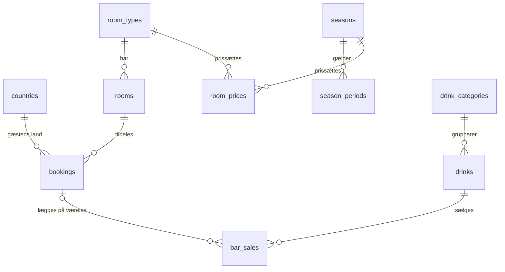

# Datamodel: Back Office – bookinger og barsalg

**Feature**: `001-backoffice-bookinger` | **Dato**: 2026-10-27

Modellen følger `docs/retningslinjer/database.md`: 3NF, constraints i databasen, `snake_case`,
tabeller i flertal og `DECIMAL` til penge. Ved implementering bliver `db/01_schema.sql`
sandheden. Dette dokument beskriver designet og begrundelserne. Er de uenige, gælder
`db/01_schema.sql`.

## ER-oversigt

## Tabeller

### `countries`
| Kolonne | Type | Constraints |
|---|---|---|
| `code` | `CHAR(2)` | PK. ISO 3166-1 alpha-2 |
| `name` | `VARCHAR(100)` | NOT NULL. Dansk navn |

En naturlig nøgle bruges, fordi ISO-koder er stabile.

### `room_types`
| Kolonne | Type | Constraints |
|---|---|---|
| `id` | `INT AUTO_INCREMENT` | PK |
| `name` | `VARCHAR(50)` | NOT NULL, UNIQUE |
| `capacity` | `TINYINT UNSIGNED` | NOT NULL, `CHECK (capacity > 0)` |

### `rooms`
| Kolonne | Type | Constraints |
|---|---|---|
| `id` | `INT AUTO_INCREMENT` | PK |
| `room_number` | `VARCHAR(10)` | NOT NULL, UNIQUE |
| `room_type_id` | `INT` | NOT NULL, FK → `room_types.id` |

### `seasons`
| Kolonne | Type | Constraints |
|---|---|---|
| `id` | `INT AUTO_INCREMENT` | PK |
| `name` | `VARCHAR(50)` | NOT NULL, UNIQUE (fx Lavsæson, Mellemsæson, Højsæson) |

### `season_periods`
| Kolonne | Type | Constraints |
|---|---|---|
| `id` | `INT AUTO_INCREMENT` | PK |
| `season_id` | `INT` | NOT NULL, FK → `seasons.id` |
| `start_date` | `DATE` | NOT NULL |
| `end_date` | `DATE` | NOT NULL, `CHECK (end_date >= start_date)`, inklusiv |

- Index på `(start_date, end_date)`.
- Perioder må ikke overlappe og skal dække hele året. MySQL kan ikke håndhæve det med en
  `CHECK`, så det sikres af seed-generatoren. Prisberegningen afviser huller med
  `PRICE_NOT_CONFIGURED`.

### `room_prices`
| Kolonne | Type | Constraints |
|---|---|---|
| `room_type_id` | `INT` | PK (sammensat), FK → `room_types.id` |
| `season_id` | `INT` | PK (sammensat), FK → `seasons.id` |
| `price_per_night` | `DECIMAL(10,2)` | NOT NULL, `CHECK (price_per_night >= 0)` |

Ren relationstabel, så den har sammensat primærnøgle `(room_type_id, season_id)` i stedet for
`id` (undtagelse i `docs/retningslinjer/database.md`).

### `bookings`
| Kolonne | Type | Constraints |
|---|---|---|
| `id` | `INT AUTO_INCREMENT` | PK |
| `guest_name` | `VARCHAR(150)` | NOT NULL, `CHECK (CHAR_LENGTH(TRIM(guest_name)) > 0)` |
| `country_code` | `CHAR(2)` | NOT NULL, FK → `countries.code` |
| `room_id` | `INT` | NOT NULL, FK → `rooms.id` |
| `check_in` | `DATE` | NOT NULL |
| `check_out` | `DATE` | NOT NULL, `CHECK (check_out > check_in)` |
| `guest_count` | `TINYINT UNSIGNED` | NOT NULL, `CHECK (guest_count > 0)` |
| `total_price` | `DECIMAL(10,2)` | NOT NULL, `CHECK (total_price >= 0)` |
| `source` | `ENUM('backoffice','booking_system')` | NOT NULL, DEFAULT `'backoffice'` |
| `created_at` | `DATETIME` | NOT NULL, DEFAULT `CURRENT_TIMESTAMP` |

> **Ændret af 004**: `guest_name` er erstattet af `first_name VARCHAR(75)` og
> `family_name VARCHAR(75)`, begge `NOT NULL` med `CHECK (CHAR_LENGTH(TRIM(...)) > 0)` (1NF).
> Indexet på `guest_name` er fjernet uden erstatning, fordi søgningen er `LIKE '%…%'`. Se
> [004 data-model](../004-opgavedata/data-model.md).

- Indexes: `(room_id, check_in, check_out)` til overlap-tjek, `(check_in)` til listen og
  `(guest_name)` til søgning (FR-002). Søgningen ignorerer store/små bogstaver og accenter,
  fordi tabellerne bruger MySQL 8.4's standard-collation `utf8mb4_0900_ai_ci`.
- **Gæsten ligger på bookingen.** Der er ingen gæsteidentitet (fx e-mail) i scope, så en
  `guests`-tabel ville være 1:1 med bookingen. Modellen er stadig 3NF, og sletning af en
  booking fjerner gæstens persondata.
- **Ingen `room_type_id`.** Værelsestypen afledes af `rooms.room_type_id`. Hvis den også lå på
  bookingen, ville det være en transitiv afhængighed (3NF-brud), og de to kunne blive uenige.
- **`total_price` er en bevidst undtagelse**: et fastfrosset historisk faktum (FR-009).
- **`source` som ENUM**: to faste systemværdier, som ikke vedligeholdes som data. En
  opslagstabel ville give en join uden gevinst.
- Antal nætter og opholdsstatus gemmes **ikke**. De afledes (se nedenfor).

### `drink_categories`
| Kolonne | Type | Constraints |
|---|---|---|
| `id` | `INT AUTO_INCREMENT` | PK |
| `name` | `VARCHAR(50)` | NOT NULL, UNIQUE (Cocktail, Kaffe) |

### `drinks`
| Kolonne | Type | Constraints |
|---|---|---|
| `id` | `INT AUTO_INCREMENT` | PK |
| `name` | `VARCHAR(100)` | NOT NULL, UNIQUE |
| `drink_category_id` | `INT` | NOT NULL, FK → `drink_categories.id` |
| `price` | `DECIMAL(10,2)` | NOT NULL, `CHECK (price >= 0)` |

### `bar_sales`
| Kolonne | Type | Constraints |
|---|---|---|
| `id` | `INT AUTO_INCREMENT` | PK |
| `drink_id` | `INT` | NOT NULL, FK → `drinks.id` |
| `quantity` | `SMALLINT UNSIGNED` | NOT NULL, `CHECK (quantity >= 1)` |
| `unit_price` | `DECIMAL(10,2)` | NOT NULL, `CHECK (unit_price >= 0)` |
| `sold_at` | `DATETIME` | NOT NULL, DEFAULT `CURRENT_TIMESTAMP` |
| `booking_id` | `INT` | NULL, FK → `bookings.id` **ON DELETE SET NULL** (FR-010a) |

- Index på `(sold_at)`.
- `created_at` og `sold_at` returneres som lokal tid (Europe/Copenhagen) uden offset,
  `'YYYY-MM-DDTHH:mm:ss'`. Databasen og backend kører med `TZ=Europe/Copenhagen`.
- **`unit_price` er en bevidst undtagelse**: prisen på salgstidspunktet (FR-010).

### `users`
| Kolonne | Type | Constraints |
|---|---|---|
| `id` | `INT AUTO_INCREMENT` | PK |
| `username` | `VARCHAR(50)` | NOT NULL, UNIQUE |
| `password_hash` | `VARCHAR(255)` | NOT NULL. Format `scrypt$<salt-hex>$<hash-hex>` |

`users` er ikke i seed. Backend opretter kontoen ved start fra `SEED_USERNAME` og
`SEED_PASSWORD` i `.env`, hvis tabellen er tom.

## Ophold, status og visninger

`today` er dags dato i Europe/Copenhagen (`backend/src/today.js`) og injiceres i services.

- **Gæsten bor på hotellet på dato d** ⇔ `check_in <= d < check_out`. Det er den eneste
  definition, og den ligger i `bookingService` (`isInHouseOn(booking, d)` og
  `viewToDateBounds`).
- **Status** (`bookingService.deriveStatus`):
  - `upcoming`: `today < check_in`
  - `arriving`: `today = check_in`
  - `in_house`: `check_in < today < check_out`
  - `departed`: `today >= check_out`
- **Visninger** oversættes i servicen til neutrale datogrænser. Repositoriet får kun
  parametrene `checkInAfter`, `checkInOnOrBefore`, `checkOutAfter` og `checkOutOnOrBefore`:
  - `upcoming`: `check_in > today`
  - `in_house`: `check_in <= today AND check_out > today` (inkluderer `arriving`)
  - `departed`: `check_out <= today`
  - `all`: ingen grænser
- Visningerne er disjunkte, og `upcoming + in_house + departed = all`. Er `q` eller `date`
  sat, bruger servicen `all`.
- Barsalg på booking er tilladt, når `isInHouseOn(booking, salgsdato)`. Det inkluderer
  ankomstdagen og udelukker afrejsedagen.

## Afledte værdier (beregnes i backend, gemmes aldrig)

Frontend regner ingenting. Den viser de værdier, API'et returnerer.

| Værdi | Formel | Hvor |
|---|---|---|
| Nætter (`nights`) | `check_out − check_in` i dage | `bookingService` |
| Værelsestype for booking | `rooms.room_type_id` (join) | `bookingRepository` |
| Opholdsstatus (`status`) | Se ovenfor | `bookingService.deriveStatus` |
| Antal og samlet pris i listen (`total`, `totalPrice`) | `COUNT` og `COALESCE(SUM(total_price), 0)` over alle matchende rækker, ikke kun `limit` | `bookingRepository` (SQL), `bookingService` |
| Antal pr. visning (`counts`) | Antal for `upcoming`, `in_house`, `departed` og `all` med de aktuelle `q`/`date`-filtre | `bookingService` |
| Barsalgets beløb (`amount`) | `quantity × unit_price` | `barService` |
| Dagens barsalg (`total`) | `COALESCE(SUM(quantity * unit_price), 0)` | `barRepository` (SQL), `barService` |
| Opholdets pris | Σ pr. nat af `room_prices` for sæsonen, natten ligger i | `pricing.calculateStayPrice` |

Alle summer i SQL bruger `COALESCE(SUM(…), 0)`, så en tom periode giver 0 og ikke `NULL`.

## Valideringsregler (fra spec)

| Regel | Database | Service (dansk besked) | Fejlkode |
|---|---|---|---|
| Gæstens navn udfyldt | `CHECK` + OpenAPI `pattern: '\S'` | ja, trimmer ("Gæstens navn skal udfyldes") | `VALIDATION_ERROR` 400 (felt `guestName`) |
| Afrejse efter ankomst | `CHECK` | ja | `VALIDATION_ERROR` 400 (felt `checkOut`) |
| Antal gæster ≥ 1 | `CHECK` + OpenAPI `minimum` | – | `VALIDATION_ERROR` 400 |
| Antal gæster ≤ kapacitet (FR-006) | – | ja (i quote kun hvis `guestCount` er givet) | `CAPACITY_EXCEEDED` 422 (felt `guestCount`) |
| Værelsestype findes | FK | ja | `VALIDATION_ERROR` 400 (felt `roomTypeId`) |
| Ledigt værelse af typen (FR-007) | – | ja, transaktion + `FOR UPDATE` (quote giver `availableRooms: 0` og aldrig 409) | `ROOM_TYPE_FULLY_BOOKED` 409 |
| Pris findes for alle nætter | – | ja | `PRICE_NOT_CONFIGURED` 422 |
| Land findes (ikke i quote) | FK | ja | `VALIDATION_ERROR` 400 (felt `countryCode`) |
| Barsalg på booking kun hvis gæsten bor på hotellet på salgsdatoen (FR-010a) | – | ja | `BOOKING_NOT_IN_HOUSE` 422 (felt `bookingId`) |
| Drink findes | FK | ja ("Ukendt drink") | `VALIDATION_ERROR` 400 (felt `drinkId`) |
| Antal drinks ≥ 1 | `CHECK` + OpenAPI | – | `VALIDATION_ERROR` 400 |

> **Ændret af 004**: Reglen "Gæstens navn udfyldt" er erstattet af "Fornavn udfyldt" (felt
> `firstName`) og "Efternavn udfyldt" (felt `familyName`). Se
> [004 data-model](../004-opgavedata/data-model.md) § Valideringsregler.

## Livscyklus

Bookingen har ingen gemt tilstandsmaskine. Den oprettes, kan redigeres frit (pris og værelse
beregnes igen) og slettes (hard delete). Barsalg, der er knyttet til en slettet booking,
bevares med `booking_id = NULL`. Sletning fjerner også gæstens navn og land. Opholdsstatus
følger kalenderen og afledes af datoerne.
