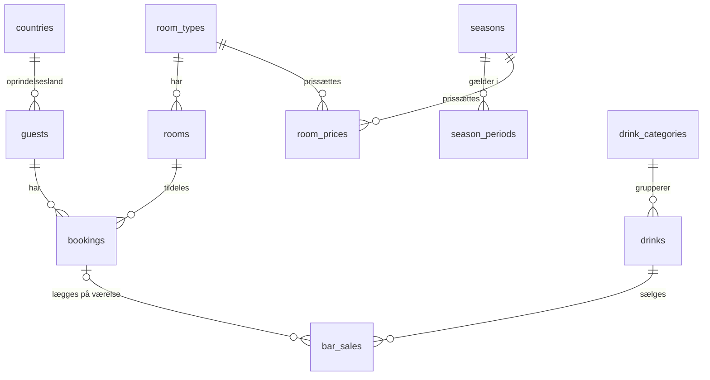

# Datamodel: Back Office – bookinger og barsalg

**Feature**: `001-backoffice-bookinger` | **Dato**: 2026-10-27

Modellen følger `docs/retningslinjer/database.md`: 3NF, constraints i databasen, `snake_case`,
tabeller i flertal og `DECIMAL` til penge. Ved implementering bliver `db/01_schema.sql`
sandheden. Dette dokument beskriver designet og begrundelserne.

## ER-oversigt

## Tabeller

### `countries`
| Kolonne | Type | Constraints |
|---|---|---|
| `code` | `CHAR(2)` | PK. ISO 3166-1 alpha-2 |
| `name` | `VARCHAR(100)` | NOT NULL. Dansk navn |

En naturlig nøgle bruges, fordi ISO-koder er stabile.

### `guests`
| Kolonne | Type | Constraints |
|---|---|---|
| `id` | `INT AUTO_INCREMENT` | PK |
| `name` | `VARCHAR(150)` | NOT NULL, `CHECK (CHAR_LENGTH(TRIM(name)) > 0)` |
| `country_code` | `CHAR(2)` | NOT NULL, FK → `countries.code` |

- Index på `name` til søgning (FR-002).
- Gæster dedupliceres ikke. Der er ingen entydig identitet (fx e-mail) i scope, så én gæst
  oprettes pr. booking. Rediger booking opdaterer gæstens navn og land.

### `room_types`
| Kolonne | Type | Constraints |
|---|---|---|
| `id` | `INT AUTO_INCREMENT` | PK |
| `name` | `VARCHAR(50)` | NOT NULL, UNIQUE |
| `capacity` | `TINYINT UNSIGNED` | NOT NULL, `CHECK (capacity > 0)` |

### `rooms`
| Kolonne | Type | Constraints |
|---|---|---|
| `id` | `INT AUTO_INCREMENT` | PK |
| `room_number` | `VARCHAR(10)` | NOT NULL, UNIQUE |
| `room_type_id` | `INT` | NOT NULL, FK → `room_types.id` |

### `seasons`
| Kolonne | Type | Constraints |
|---|---|---|
| `id` | `INT AUTO_INCREMENT` | PK |
| `name` | `VARCHAR(50)` | NOT NULL, UNIQUE (fx Lavsæson, Mellemsæson, Højsæson) |

### `season_periods`
| Kolonne | Type | Constraints |
|---|---|---|
| `id` | `INT AUTO_INCREMENT` | PK |
| `season_id` | `INT` | NOT NULL, FK → `seasons.id` |
| `start_date` | `DATE` | NOT NULL |
| `end_date` | `DATE` | NOT NULL, `CHECK (end_date >= start_date)`, inklusiv |

- Index på `(start_date, end_date)`.
- Perioder må ikke overlappe og skal dække hele året. MySQL kan ikke håndhæve det med en
  `CHECK`, så det sikres af seed-generatoren. Prisberegningen afviser huller med
  `PRICE_NOT_CONFIGURED`.

### `room_prices`
| Kolonne | Type | Constraints |
|---|---|---|
| `room_type_id` | `INT` | PK (sammensat), FK → `room_types.id` |
| `season_id` | `INT` | PK (sammensat), FK → `seasons.id` |
| `price_per_night` | `DECIMAL(10,2)` | NOT NULL, `CHECK (price_per_night >= 0)` |

### `bookings`
| Kolonne | Type | Constraints |
|---|---|---|
| `id` | `INT AUTO_INCREMENT` | PK |
| `guest_id` | `INT` | NOT NULL, FK → `guests.id` |
| `room_id` | `INT` | NOT NULL, FK → `rooms.id` |
| `check_in` | `DATE` | NOT NULL |
| `check_out` | `DATE` | NOT NULL, `CHECK (check_out > check_in)` |
| `guests` | `TINYINT UNSIGNED` | NOT NULL, `CHECK (guests > 0)` |
| `total_price` | `DECIMAL(10,2)` | NOT NULL, `CHECK (total_price >= 0)` |
| `source` | `ENUM('backoffice','booking_system')` | NOT NULL, DEFAULT `'backoffice'` |
| `created_at` | `DATETIME` | NOT NULL, DEFAULT `CURRENT_TIMESTAMP` |
| `updated_at` | `DATETIME` | NOT NULL, DEFAULT `CURRENT_TIMESTAMP ON UPDATE CURRENT_TIMESTAMP` |

- Indexes: `(room_id, check_in, check_out)` til overlap-tjek og `(check_in)` til listen.
- **Ingen `room_type_id`.** Værelsestypen afledes af `rooms.room_type_id`. Hvis den også lå på
  bookingen, ville det være en transitiv afhængighed (3NF-brud), og de to kunne blive uenige.
- **`total_price` er en bevidst undtagelse**: et fastfrosset historisk faktum (FR-009).
- **`source` som ENUM**: to faste systemværdier, som ikke vedligeholdes som data. En
  opslagstabel ville give en join uden gevinst.
- Antal nætter og opholdsstatus gemmes **ikke**. De afledes (se nedenfor).

### `drink_categories`
| Kolonne | Type | Constraints |
|---|---|---|
| `id` | `INT AUTO_INCREMENT` | PK |
| `name` | `VARCHAR(50)` | NOT NULL, UNIQUE (Cocktail, Kaffe) |

### `drinks`
| Kolonne | Type | Constraints |
|---|---|---|
| `id` | `INT AUTO_INCREMENT` | PK |
| `name` | `VARCHAR(100)` | NOT NULL, UNIQUE |
| `drink_category_id` | `INT` | NOT NULL, FK → `drink_categories.id` |
| `price` | `DECIMAL(10,2)` | NOT NULL, `CHECK (price >= 0)` |
| `is_active` | `BOOLEAN` | NOT NULL, DEFAULT TRUE. Inaktive drinks vises ikke ved salg, men historikken bevares |

### `bar_sales`
| Kolonne | Type | Constraints |
|---|---|---|
| `id` | `INT AUTO_INCREMENT` | PK |
| `drink_id` | `INT` | NOT NULL, FK → `drinks.id` |
| `quantity` | `SMALLINT UNSIGNED` | NOT NULL, `CHECK (quantity >= 1)` |
| `unit_price` | `DECIMAL(10,2)` | NOT NULL, `CHECK (unit_price >= 0)` |
| `sold_at` | `DATETIME` | NOT NULL, DEFAULT `CURRENT_TIMESTAMP` |
| `booking_id` | `INT` | NULL, FK → `bookings.id` **ON DELETE SET NULL** (FR-010a) |

- Index på `(sold_at)`.
- **`unit_price` er en bevidst undtagelse**: prisen på salgstidspunktet (FR-010).

### `users`
| Kolonne | Type | Constraints |
|---|---|---|
| `id` | `INT AUTO_INCREMENT` | PK |
| `username` | `VARCHAR(50)` | NOT NULL, UNIQUE |
| `password_hash` | `VARCHAR(255)` | NOT NULL. Format `scrypt$<salt-hex>$<hash-hex>` |

## Afledte værdier (beregnes i services, gemmes aldrig)

| Værdi | Formel | Hvor |
|---|---|---|
| Nætter | `check_out − check_in` i dage | `bookingService` |
| Værelsestype for booking | `rooms.room_type_id` (join) | `bookingRepository` |
| Opholdsstatus | `upcoming`: `today < check_in` `arriving`: `today = check_in` `in_house`: `check_in < today < check_out` `departed`: `today ≥ check_out` | `bookingService` |
| Barsalgets beløb | `quantity × unit_price` | `barService` |
| Opholdets pris | Σ pr. nat af `room_prices` for sæsonen, natten ligger i | `pricing.calculateStayPrice` |

## Valideringsregler (fra spec)

| Regel | Database | Service (dansk besked) | Fejlkode |
|---|---|---|---|
| Afrejse efter ankomst | `CHECK` | ja | `VALIDATION_ERROR` (felt `checkOut`) |
| Gæster ≥ 1 | `CHECK` + OpenAPI `minimum` | – | `VALIDATION_ERROR` |
| Gæster ≤ kapacitet (FR-006) | – | ja | `CAPACITY_EXCEEDED` (felt `guests`) |
| Ledigt værelse af typen (FR-007) | – | ja, transaktion + `FOR UPDATE` | `ROOM_TYPE_FULLY_BOOKED` |
| Pris findes for alle nætter | – | ja | `PRICE_NOT_CONFIGURED` |
| Land findes | FK | ja | `VALIDATION_ERROR` (felt `countryCode`) |
| Barsalg på booking kun hvis gæsten er i huset på salgsdatoen (FR-010a) | – | ja | `BOOKING_NOT_IN_HOUSE` (felt `bookingId`) |
| Antal drinks ≥ 1 | `CHECK` + OpenAPI | – | `VALIDATION_ERROR` |

## Livscyklus

Bookingen har ingen gemt tilstandsmaskine. Den oprettes, kan redigeres frit (pris og værelse
beregnes igen) og slettes (hard delete). Barsalg, der er knyttet til en slettet booking,
bevares med `booking_id = NULL`. Opholdsstatus følger kalenderen og afledes af datoerne.
