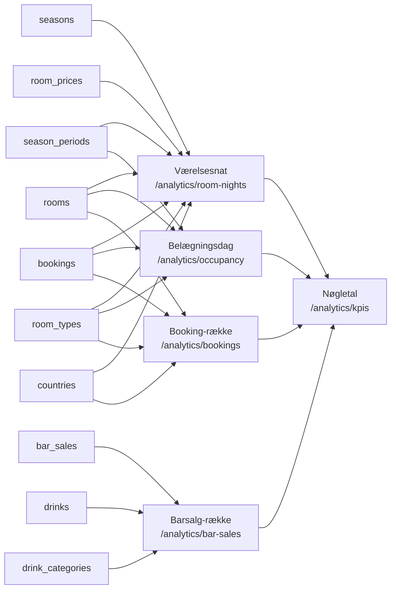

# Datamodel: Business Intelligence – ledelsesdashboard

**Feature**: `002-bi-dashboard` | **Dato**: 2026-10-30

**Ingen nye tabeller.** Feature 002 læser kun de tabeller, som
[`001-backoffice-bookinger/data-model.md`](../001-backoffice-bookinger/data-model.md)
beskriver, og `db/01_schema.sql` er uændret. Alt i dette dokument er **afledte entiteter**. De
beregnes i `backend/src/services/analyticsService.js` ved hvert kald og gemmes aldrig
(`docs/retningslinjer/database.md`, "Gem aldrig afledte data", research R6).

Hver afledt entitet svarer til ét endpoint under `/api/analytics`. Feltnavne og typer står i
[`backend/openapi.yaml`](../../backend/openapi.yaml), som er sandheden. Tabellerne nedenfor
viser kun, hvor hvert felt kommer fra.

## Oversigt

## Værelsesnat

Én nat for ét værelse i én booking (specens nøgleentitet). Det er den mindste enhed for
fordeling af indtjening (FR-003–FR-006, FR-015). Natten `d` tilhører bookingen, når
`check_in <= d < check_out`. Det er samme definition som i `pricing.js`.

| Felt | Afledt af |
|---|---|
| `bookingId` | `bookings.id` |
| `date` | Nattens dato |
| `year`, `month` | Nattens dato, så ophold over års- og månedsskifte fordeles rigtigt |
| `season` | `seasons.name` for den `season_periods`-række, der indeholder datoen |
| `roomType` | `room_types.name` via `bookings.room_id → rooms.room_type_id` |
| `countryCode`, `country` | `bookings.country_code` og `countries.name` |
| `revenue` | Nattens andel af `bookings.total_price`, vægtet med `room_prices.price_per_night` for (værelsestype, sæson). Resten af ørerne ligger på sidste nat (research R5) |

**Invarianter** (testes i `backend/test/analyticsService.test.js`):

- Summen af `revenue` over en bookings nætter er præcis `total_price`.
- Antallet af nætter er `check_out − check_in` i dage.
- Er alle vægte 0, er nætterne lige store (bortset fra resten på sidste nat).

## Belægningsdag

Én række pr. dato × værelsestype for hver dato, der er dækket af `season_periods`. Rækken er
grundlaget for belægningsgrad (FR-001, FT5).

| Felt | Afledt af |
|---|---|
| `date`, `year`, `month` | Datoen |
| `season` | `seasons.name` for perioden, der indeholder datoen |
| `roomType` | `room_types.name` |
| `availableRoomNights` | Antal `rooms` af typen. Værelser ude af drift modelleres ikke (spec, Assumptions) |
| `soldRoomNights` | Antal bookinger af typen, hvor `check_in <= date < check_out` |
| `occupancyRate` | `soldRoomNights ÷ availableRoomNights`, og 0, når nævneren er 0 |

`soldRoomNights` kan ikke overstige `availableRoomNights`, fordi et værelse aldrig har to
overlappende bookinger (001 FR-007). I Tableau må `occupancyRate` ikke gennemsnittes på tværs
af rækker. Et udsnit vises som `SUM(soldRoomNights) / SUM(availableRoomNights)` (research R4).

## Booking-række

Én række pr. booking, så antal bookinger, gæster og opholdslængde kan tælles uden at blive
talt med én gang pr. nat (FR-002, FT6).

| Felt | Afledt af |
|---|---|
| `bookingId`, `checkIn`, `checkOut`, `guestCount` | `bookings` |
| `year`, `month` | `check_in`. En booking tælles i det år og den måned, gæsten ankommer |
| `roomType` | `room_types.name` via `rooms` |
| `countryCode`, `country` | `bookings.country_code` og `countries.name` |
| `nights` | `check_out − check_in` i dage. Gemmes ikke (001 data-model) |
| `revenue` | `bookings.total_price` |

## Barsalg-række

Én række pr. barsalg (FR-008, FR-009, FT13, FT14).

| Felt | Afledt af |
|---|---|
| `saleId`, `quantity` | `bar_sales` |
| `date`, `year`, `month` | Datodelen af `bar_sales.sold_at` (lokal tid) |
| `drink` | `drinks.name` |
| `category` | `drink_categories.name` |
| `revenue` | `quantity × bar_sales.unit_price` (den fastfrosne pris, 001 FR-010) |

## Nøgletal

Specens entitet **Nøgletal**: et beregnet tal med navn, værdi, enhed og dimension. Der er en
række pr. nøgletal pr. kalenderår, for hvert år med værelsesnætter eller barsalg.
`generatedAt` er tidspunktet for svaret (FR-016, research R7).

| `kpi` | Formel (i `analyticsService`) | `unit` | Krav |
|---|---|---|---|
| `occupancyRate` | Solgte værelsesnætter i året ÷ tilgængelige værelsesnætter i året | `percent` | FR-001, FT5 |
| `roomRevenue` | Σ `revenue` for værelsesnætter i året | `DKK` | FR-006, FT10, FR-015 |
| `avgPricePerNight` | `roomRevenue` ÷ solgte værelsesnætter i året | `DKK` | FR-007, FT11 |
| `avgStayLength` | Gennemsnit af `nights` for bookinger med ankomst i året | `nights` | FR-007, FT11 |
| `bookings` | Antal bookinger med ankomst i året | `count` | FR-002, FT6 |
| `guests` | Σ `guestCount` for bookinger med ankomst i året | `count` | FR-002, FT6 |
| `barRevenue` | Σ barsalgets `revenue` i året | `DKK` | FR-008, FT13 |
| `barRevenueShare` | Kategoriens baromsætning ÷ årets baromsætning, én række pr. kategori med `dimension` = kategoriens navn | `percent` | FR-010, FT15 |

Regler:

- `dimension` er `null` undtagen på `barRevenueShare`.
- Procenter er brøker mellem 0 og 1. Tableau formaterer dem.
- En nævner på 0 giver 0, aldrig `NaN` eller `null` (edge case: periode uden data).
- Andelene for et år summerer til præcis 1, når der er barsalg.
- Kategorierne kommer fra `drink_categories`. "Cocktail" og "Kaffe" er ikke hardcodet.
- `label` er det danske navn, som dashboardet viser (fx "Belægningsgrad").

> **Udvidet af 003**: `customerSatisfaction` og `satisfactionResponses` (FT12) er to nye rækker
> pr. år, og årene omfatter også år med afrejser. Se
> [003 data-model.md § Nøgletal](../003-receptionsoverblik/data-model.md#afledt-nøgletal-udvidelse-af-002).

## Edge cases fra spec'en

| Edge case | Hvordan modellen håndterer det |
|---|---|
| Ophold over sæson- eller årsskifte | Værelsesnætter har nattens egen sæson, måned og år |
| Slettede bookinger | Bookinger slettes hårdt (001), så de indgår ikke nogen steder. Barsalg på dem bevares med `booking_id = NULL` og tæller stadig med i barsalget |
| Booking uden land | Kan ikke opstå. `bookings.country_code` er `NOT NULL` med FK til `countries`. Derfor er der ingen "Ukendt"-kode |
| Drink ikke længere på kortet | Drinks slettes ikke, mens der findes salg (FK), og salget bruger den fastfrosne `unit_price` |
| År eller periode uden data | Nævnere på 0 giver 0. Belægningsdage findes for alle datoer i `season_periods`, også uden salg |
| API'et er utilgængeligt | Tableau-extractet beholder de seneste data og deres `generatedAt` (research R7) |
