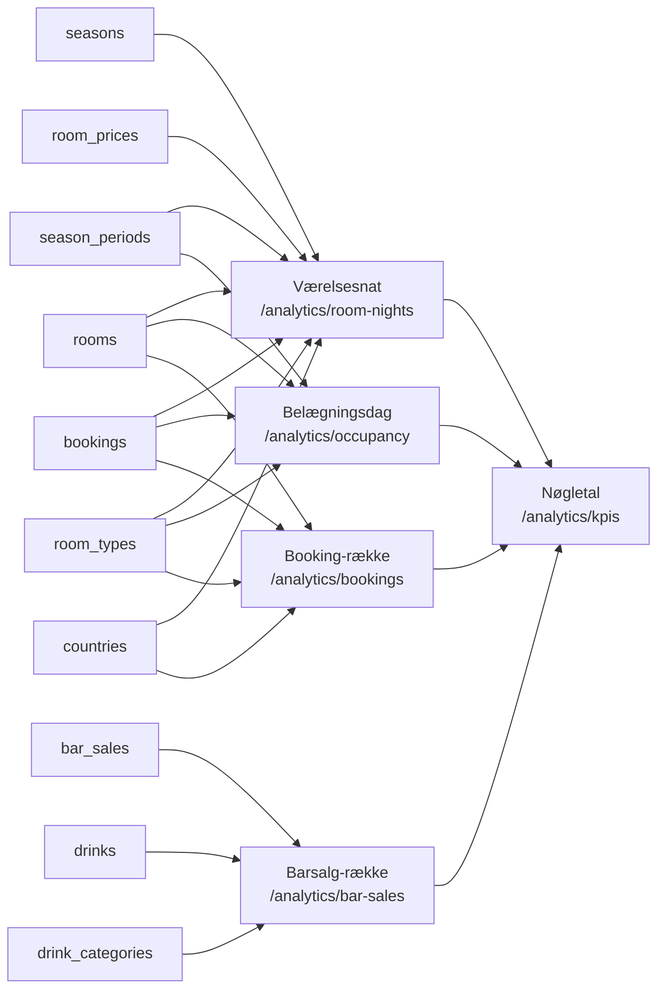
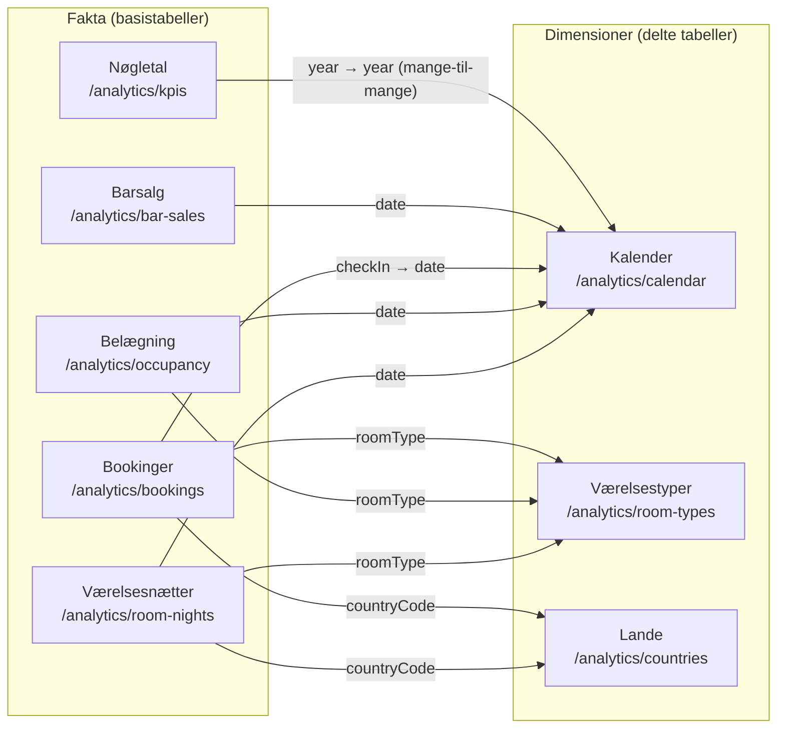

# Datamodel: Business Intelligence – ledelsesdashboard

**Feature**: `002-bi-dashboard` | **Dato**: 2026-10-30

**Ingen nye tabeller.** Feature 002 læser kun de tabeller, som
[`001-backoffice-bookinger/data-model.md`](../001-backoffice-bookinger/data-model.md)
beskriver, og `db/01_schema.sql` er uændret. Alt i dette dokument er **afledte entiteter**. De
beregnes i `backend/src/services/analyticsService.js` ved hvert kald og gemmes aldrig
(`docs/retningslinjer/database.md`, "Gem aldrig afledte data", research R6).

Hver afledt entitet svarer til ét endpoint under `/api/analytics`. Feltnavne og typer står i
[`backend/openapi.yaml`](../../backend/openapi.yaml), som er sandheden. Tabellerne nedenfor
viser kun, hvor hvert felt kommer fra.

> **Ændret 2026-10-30 (stjerneskema)**: Tre dimensioner er tilføjet (Kalender, Værelsestyper og
> Lande), og `year`, `month`, `season` og `country` er fjernet fra fakta (research R8–R11). Se
> [§ Stjerneskema](#stjerneskema-ændring-2026-10-30). Fjernede felter står med ~~gennemstreg~~
> nedenfor.

## Oversigt

## Stjerneskema (ændring 2026-10-30)

Dashboardet bruger **én** Tableau-datakilde med tre dimensioner og fem fakta (research R8).
Fakta har kun nøgler og mål. Beskrivende felter (år, måned, sæson og landenavn) bor kun i
dimensionerne (research R11). Fakta relateres kun til dimensioner og aldrig til hinanden.

### Dimension: Kalender (`/analytics/calendar`)

Én række pr. dato i hele kalenderår fra det tidligste til det seneste år blandt
sæsonperioderne, bookingernes `check_in`/`check_out` og barsalgenes datoer (research R10).

| Felt | Nøgle | Afledt af |
|---|---|---|
| `date` | **ja** (unik) | Hver dato i årene |
| `year`, `month` | – | Datoen (heltal, `month` 1–12) |
| `season` | – | `seasons.name` for den `season_periods`-række, der dækker datoen. `null` uden for alle perioder |

### Dimension: Værelsestyper (`/analytics/room-types`)

Én række pr. række i `room_types`, sorteret efter `id`, også typer uden værelser eller salg.

| Felt | Nøgle | Afledt af |
|---|---|---|
| `roomType` | **ja** (unik, `room_types.name` er `UNIQUE`) | `room_types.name` |
| `capacity` | – | `room_types.capacity` |
| `rooms` | – | Antal `rooms` af typen (0, når der ingen er) |

### Dimension: Lande (`/analytics/countries`)

Én række pr. række i `countries`, også lande uden bookinger.

| Felt | Nøgle | Afledt af |
|---|---|---|
| `countryCode` | **ja** (ISO 3166-1 alpha-2, primærnøgle) | `countries.code` |
| `country` | – | `countries.name` (dansk) |

### Fakta og deres nøgler

| Faktatabel (Tableau-navn) | Endpoint | Én række pr. | Nøgler til dimensioner | Mål og øvrige felter |
|---|---|---|---|---|
| Værelsesnætter | `/analytics/room-nights` | solgt værelsesnat | `date`, `roomType`, `countryCode` | `bookingId`, `revenue` |
| Belægning | `/analytics/occupancy` | dato × værelsestype | `date`, `roomType` | `availableRoomNights`, `soldRoomNights`, `occupancyRate` |
| Bookinger | `/analytics/bookings` | booking | `checkIn`, `roomType`, `countryCode` | `bookingId`, `checkOut`, `guestCount`, `nights`, `revenue`, `satisfactionScore` |
| Barsalg | `/analytics/bar-sales` | barsalg | `date` | `saleId`, `drink`, `category`, `quantity`, `revenue` |
| Nøgletal | `/analytics/kpis` | nøgletal × kalenderår | `year` | `kpi`, `label`, `dimension`, `value`, `unit`, `generatedAt` |

`satisfactionScore` på Bookinger følger ankomstdatoen i Kalender, men nøgletallet
Kundetilfredshed tæller i afrejseåret (003 research R8). Arket Kundetilfredshed bygges derfor
fra Nøgletal og ikke fra Bookinger, så tallet altid er lig `/analytics/kpis`.

`bookingId` på Værelsesnætter er kun en identifikation. Den relateres **ikke** til Bookinger,
fordi to fakta aldrig relateres (det ville give en cyklus, research R8).

### Relationer i Tableau

Venstre side er faktatabellen (basistabel), højre side dimensionen (delt tabel). Felttyperne
skal være ens på begge sider, før relationen oprettes: `date`/`checkIn` som **Date**,
`year` som **Number (whole)** og resten som **String**.

| # | Faktatabel.felt | Dimension.felt | Kardinalitet i data | Performance Options i Tableau |
|---|---|---|---|---|
| 1 | Værelsesnætter.`date` | Kalender.`date` | mange → én | Standard: Many / Many, Some records match |
| 2 | Værelsesnætter.`roomType` | Værelsestyper.`roomType` | mange → én | Standard |
| 3 | Værelsesnætter.`countryCode` | Lande.`countryCode` | mange → én | Standard |
| 4 | Belægning.`date` | Kalender.`date` | mange → én | Standard |
| 5 | Belægning.`roomType` | Værelsestyper.`roomType` | mange → én | Standard |
| 6 | Bookinger.`checkIn` | Kalender.`date` | mange → én | Standard |
| 7 | Bookinger.`roomType` | Værelsestyper.`roomType` | mange → én | Standard |
| 8 | Bookinger.`countryCode` | Lande.`countryCode` | mange → én | Standard |
| 9 | Barsalg.`date` | Kalender.`date` | mange → én | Standard |
| 10 | Nøgletal.`year` | Kalender.`year` | **mange ↔ mange** | Standard (skal være Many / Many) |

- Alle relationer beholder Tableaus standard (Many / Many, Some records match) *(foreslået af
  AI, afventer gruppen)*. Standarden er korrekt for alle ti. "One" på dimensionssiden af 1–9
  ville kun være en ydelsesindstilling, og forkerte indstillinger kan give forkerte tal
  (research R8). Relation 10 **skal** være Many / Many.
- Relationer dublerer ikke mål, heller ikke ved mange-til-mange (research R8). SUM(`value`)
  for ét nøgletal og ét år er derfor præcis værdien fra API'et.
- Regler fra Tableau: ingen cyklusser, ingen relationer mellem to fakta og ingen tabeller under
  en dimension (research R8).

### Filtermatrix

Hvilke dashboardfiltre der anvendes på hvilke fakta ("Apply to Worksheets → Selected
Worksheets"). Filtrene er felter fra dimensionerne.

| Filter (felt) | Værelsesnætter | Belægning | Bookinger | Barsalg | Nøgletal |
|---|---|---|---|---|---|
| År (`Kalender.year`, ét år ad gangen) | ✅ | ✅ | ✅ (ankomstår) | ✅ | ✅ |
| Måned (`Kalender.month`) | ✅ | ✅ | ✅ (ankomstmåned) | ✅ | – |
| Sæson (`Kalender.season`) | ✅ | ✅ | ✅ (ankomstdatoens sæson) | ✅ | – |
| Værelsestype (`Værelsestyper.roomType`) | ✅ | ✅ | ✅ | – (har ingen type) | – |
| Land (`Lande.country`) | ✅ | – (har intet land) | ✅ | – (har intet land) | – |

Nøgletal følger kun år, fordi de er autoritative årstal (FR-011, US7). Klik i et ark ("Use as
Filter") følger samme matrix. "Use as Filter" opretter en filterhandling, der som standard
rammer alle ark på dashboardet, så målarkene rettes under Dashboard → Actions efter matrixen.
Et land må fx ikke være mål for belægnings- og barsalgsarkene (F1 i quickstart Del 2).

## Værelsesnat

Én nat for ét værelse i én booking (specens nøgleentitet). Det er den mindste enhed for
fordeling af indtjening (FR-003–FR-006, FR-015). Natten `d` tilhører bookingen, når
`check_in <= d < check_out`. Det er samme definition som i `pricing.js`.

| Felt | Afledt af |
|---|---|
| `bookingId` | `bookings.id` |
| `date` | Nattens dato |
| ~~`year`, `month`~~ | Fjernet 2026-10-30. Kalender via `date`, så ophold over års- og månedsskifte stadig fordeles rigtigt |
| ~~`season`~~ | Fjernet 2026-10-30. Kalender via `date` |
| `roomType` | `room_types.name` via `bookings.room_id → rooms.room_type_id` |
| `countryCode` | `bookings.country_code`. ~~`country`~~ fjernet 2026-10-30 (Lande) |
| `revenue` | Nattens andel af `bookings.total_price`, vægtet med `room_prices.price_per_night` for (værelsestype, sæson). Resten af ørerne ligger på sidste nat (research R5) |

**Invarianter** (testes i `backend/test/analyticsService.test.js`):

- Summen af `revenue` over en bookings nætter er præcis `total_price`.
- Antallet af nætter er `check_out − check_in` i dage.
- Er alle vægte 0, er nætterne lige store (bortset fra resten på sidste nat).

## Belægningsdag

Én række pr. dato × værelsestype for hver dato, der er dækket af `season_periods`. Rækken er
grundlaget for belægningsgrad (FR-001, FT5).

| Felt | Afledt af |
|---|---|
| `date` | Datoen. ~~`year`, `month`~~ fjernet 2026-10-30 (Kalender) |
| ~~`season`~~ | Fjernet 2026-10-30 (Kalender) |
| `roomType` | `room_types.name` |
| `availableRoomNights` | Antal `rooms` af typen. Værelser ude af drift modelleres ikke (spec, Assumptions) |
| `soldRoomNights` | Antal bookinger af typen, hvor `check_in <= date < check_out` |
| `occupancyRate` | `soldRoomNights ÷ availableRoomNights`, og 0, når nævneren er 0 |

`soldRoomNights` kan ikke overstige `availableRoomNights`, fordi et værelse aldrig har to
overlappende bookinger (001 FR-007). I Tableau må `occupancyRate` ikke gennemsnittes på tværs
af rækker. Et udsnit vises som `SUM(soldRoomNights) / SUM(availableRoomNights)` (research R4).

## Booking-række

Én række pr. booking, så antal bookinger, gæster og opholdslængde kan tælles uden at blive
talt med én gang pr. nat (FR-002, FT6).

| Felt | Afledt af |
|---|---|
| `bookingId`, `checkIn`, `checkOut`, `guestCount` | `bookings` |
| ~~`year`, `month`~~ | Fjernet 2026-10-30. Kalender via `checkIn`, så en booking stadig tælles i det år og den måned, gæsten ankommer |
| `roomType` | `room_types.name` via `rooms` |
| `countryCode` | `bookings.country_code`. ~~`country`~~ fjernet 2026-10-30 (Lande) |
| `nights` | `check_out − check_in` i dage. Gemmes ikke (001 data-model) |
| `revenue` | `bookings.total_price` |

## Barsalg-række

Én række pr. barsalg (FR-008, FR-009, FT13, FT14).

| Felt | Afledt af |
|---|---|
| `saleId`, `quantity` | `bar_sales` |
| `date` | Datodelen af `bar_sales.sold_at` (lokal tid). ~~`year`, `month`~~ fjernet 2026-10-30 (Kalender) |
| `drink` | `drinks.name` |
| `category` | `drink_categories.name` |
| `revenue` | `quantity × bar_sales.unit_price` (den fastfrosne pris, 001 FR-010) |

## Nøgletal

Specens entitet **Nøgletal**: et beregnet tal med navn, værdi, enhed og dimension. Der er en
række pr. nøgletal pr. kalenderår. ~~For hvert år med værelsesnætter eller barsalg~~ Fra
2026-10-30: for **hvert år i Kalender** (research R10), så hvert år i år-filteret har nøgletal.
`generatedAt` er tidspunktet for svaret (FR-016, research R7).

| `kpi` | Formel (i `analyticsService`) | `unit` | Krav |
|---|---|---|---|
| `occupancyRate` | Solgte værelsesnætter i året ÷ tilgængelige værelsesnætter i året | `percent` | FR-001, FT5 |
| `roomRevenue` | Σ `revenue` for værelsesnætter i året | `DKK` | FR-006, FT10, FR-015 |
| `avgPricePerNight` | `roomRevenue` ÷ solgte værelsesnætter i året | `DKK` | FR-007, FT11 |
| `avgStayLength` | Gennemsnit af `nights` for bookinger med ankomst i året | `nights` | FR-007, FT11 |
| `bookings` | Antal bookinger med ankomst i året | `count` | FR-002, FT6 |
| `guests` | Σ `guestCount` for bookinger med ankomst i året | `count` | FR-002, FT6 |
| `barRevenue` | Σ barsalgets `revenue` i året | `DKK` | FR-008, FT13 |
| `barRevenueShare` | Kategoriens baromsætning ÷ årets baromsætning, én række pr. kategori med `dimension` = kategoriens navn | `percent` | FR-010, FT15 |

Regler:

- `dimension` er `null` undtagen på `barRevenueShare`.
- Procenter er brøker mellem 0 og 1. Tableau formaterer dem.
- En nævner på 0 giver 0, aldrig `NaN` eller `null` (edge case: periode uden data).
- Andelene for et år summerer til præcis 1, når der er barsalg.
- Kategorierne kommer fra `drink_categories`. "Cocktail" og "Kaffe" er ikke hardcodet.
- `label` er det danske navn, som dashboardet viser (fx "Belægningsgrad").

> **Udvidet af 003**: `customerSatisfaction` og `satisfactionResponses` (FT12) er to nye rækker
> pr. år, og årene omfatter også år med afrejser. Se
> [003 data-model.md § Nøgletal](../003-receptionsoverblik/data-model.md#afledt-nøgletal-udvidelse-af-002).

## Edge cases fra spec'en

| Edge case | Hvordan modellen håndterer det |
|---|---|
| Ophold over sæson- eller årsskifte | Værelsesnætter har nattens egen sæson, måned og år |
| Slettede bookinger | Bookinger slettes hårdt (001), så de indgår ikke nogen steder. Barsalg på dem bevares med `booking_id = NULL` og tæller stadig med i barsalget |
| Booking uden land | Kan ikke opstå. `bookings.country_code` er `NOT NULL` med FK til `countries`. Derfor er der ingen "Ukendt"-kode |
| Drink ikke længere på kortet | Drinks slettes ikke, mens der findes salg (FK), og salget bruger den fastfrosne `unit_price` |
| År eller periode uden data | Nævnere på 0 giver 0. Belægningsdage findes for alle datoer i `season_periods`, også uden salg |
| API'et er utilgængeligt | Tableau-extractet beholder de seneste data og deres `generatedAt` (research R7) |
| Dato uden for alle sæsonperioder *(2026-10-30)* | Kalender dækker hele år. Rækken har år og måned, men `season` er `null` (research R10) |
| Land eller værelsestype vælges *(2026-10-30)* | Filtret anvendes kun på fakta med feltet (filtermatrixen). Belægning og barsalg ændres ikke af et land |
| År uden data *(2026-10-30)* | Nøgletal har rækker for alle kalenderens år med 0 (research R10) |
